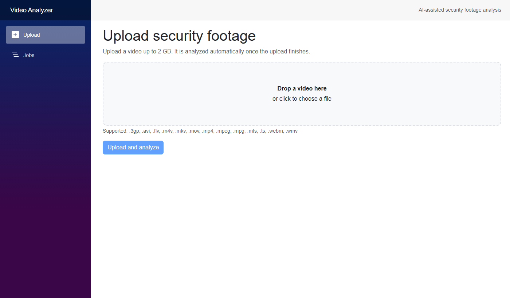
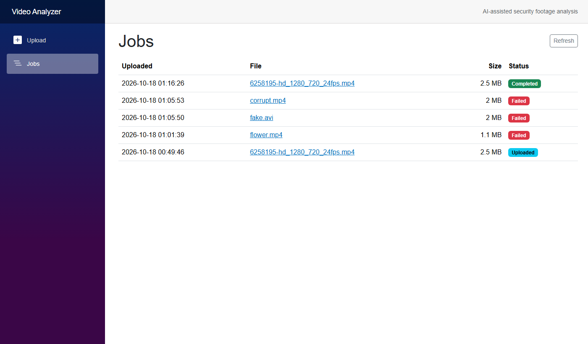
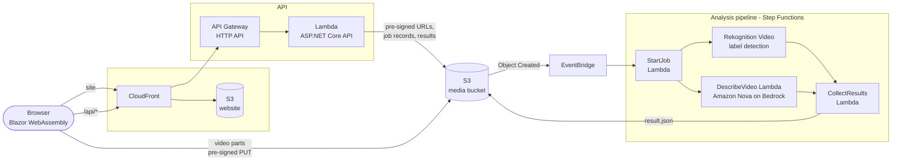

# Video Analyzer

**AI-assisted analysis of security camera footage, fully serverless on AWS.**

Upload a video from the browser. AWS analyzes it automatically and the same website shows what
happened: who appears, what they look like and wear, what they do and when, which vehicles and
text are visible, and which moments an investigator should look at first. Every timestamp is
clickable and jumps the video player to that moment.

[](https://github.com/KayDeeStar/video-analyzer/actions/workflows/deploy.yml)

> **Status: work in progress.** Uploading, the analysis pipeline (Amazon Rekognition), the results
> view and CI/CD are working. The **AI briefing with Amazon Nova** (a written, analyst-style
> description of people, clothing, actions and location) is built and deployed, and is waiting for
> AWS to enable Amazon Bedrock on the account. Coming soon. Public hosting via CloudFront is
> waiting on the same account verification.

## Screenshots

| Upload | Jobs |
|---|---|
|  |  |

## What it does

- **Large uploads straight to S3.** Videos up to 2 GB go from the browser directly to S3 in
  parallel 16 MB parts with progress, speed, retry and cancel. They never pass through the API.
- **Automatic analysis.** A finished upload triggers an AWS Step Functions workflow; no servers,
  no queues to manage.
- **AI briefing (Amazon Nova on Bedrock).** The model watches the video and writes:
  - a short summary and **notable events** with severity (vandalism, camera tampering, weapons, ...)
  - a plain-language **briefing**: individual appearance, action and behavior, location details,
    observable physical details, limitations
  - a **card per person**: apparent sex and age, height and build, hair, clothing, footwear,
    accessories, carried items, actions, face visibility
  - **vehicles** and licence plates, a **timeline**, visible text and any on-screen date/time
- **Object detection (Amazon Rekognition).** When people are visible and which objects or scenes
  appear, with low-confidence noise filtered out.
- **Re-analysis.** "Analyze again" re-runs the pipeline on an uploaded video, for example after
  the prompts or models improve.
- **Clear failures.** Unsupported or corrupt files end with a message a user can act on.

All results are machine estimates and are labelled as such; they support an investigation and do
not replace reviewing the footage.

## Architecture



1. The browser asks the API for an upload; the API creates a job and returns pre-signed S3 part URLs.
2. The browser uploads the parts directly to S3 (`uploads/{jobId}/original.ext`) and completes the upload.
3. S3 emits an "Object Created" event; EventBridge starts the Step Functions state machine.
4. The state machine marks the job `Processing`, then runs Rekognition label detection and the
   Nova description in parallel.
5. A Lambda combines both into `results/{jobId}/result.json` and marks the job `Completed`
   (or `Failed` with a readable reason). The website polls the job and shows the results.

## Tech stack

| Area | Technology |
|---|---|
| Frontend | Blazor WebAssembly (.NET 10), Bootstrap, a small JS module for direct-to-S3 multipart upload |
| API | ASP.NET Core Minimal API on AWS Lambda (.NET 10, arm64) behind API Gateway HTTP API |
| Analysis | AWS Step Functions (JSONata), Amazon Rekognition Video, Amazon Bedrock (Amazon Nova) |
| Storage | Amazon S3 (videos, job records, results; lifecycle clean-up) |
| Hosting | Amazon CloudFront + private S3 bucket (Origin Access Control), `/api/*` on the same domain |
| Infrastructure as code | Terraform (modules per area, S3 remote state with native locking) |
| CI/CD | GitHub Actions with OpenID Connect to AWS (no stored keys) |
| Tests | xUnit (upload validation, job ids, result summarizing, lenient AI-report parsing) |

## Repository layout

```
infra/
  bootstrap/          one-time: Terraform state bucket, GitHub OIDC deploy role
  modules/storage/    media bucket (videos, job status, results)
  modules/api/        C# Lambda + API Gateway HTTP API
  modules/processing/ EventBridge -> Step Functions analysis pipeline + Lambdas
  modules/frontend/   web bucket + CloudFront (site and /api/* on one domain)
  envs/dev/           dev environment composition
src/
  VideoAnalyzer.Shared/      DTOs shared by the API, pipeline and Blazor UI
  VideoAnalyzer.Core/        job/result storage in S3 (used by API and pipeline)
  VideoAnalyzer.Api/         ASP.NET Core Minimal API (runs in Lambda or locally)
  VideoAnalyzer.Processing/  Lambda handlers called by the analysis state machine
  VideoAnalyzer.Web/         Blazor WebAssembly UI
tests/
  VideoAnalyzer.Api.Tests/
  VideoAnalyzer.Processing.Tests/
scripts/
  build-lambdas.ps1   publish the Lambdas (linux-arm64) into artifacts/api and artifacts/processing
  deploy-web.ps1      publish the Blazor site to S3/CloudFront
  test-upload.ps1     end-to-end upload test against the deployed API
.github/workflows/
  ci.yml              checks for pull requests and branches
  deploy.yml          checks + deploy on pushes to main
  build-test.yml      shared build/test/terraform-validate job
```

## API

| Method | Path | Purpose |
|---|---|---|
| GET | `/api/health` | Liveness check |
| POST | `/api/uploads` | `{ fileName, fileSize }` → job id + pre-signed S3 part URLs |
| POST | `/api/uploads/{jobId}/complete` | `{ parts: [{ partNumber, eTag }] }` → finishes the upload |
| DELETE | `/api/uploads/{jobId}` | Cancel an in-progress upload |
| GET | `/api/jobs` | Recent jobs, newest first (`?limit=50`) |
| GET | `/api/jobs/{jobId}` | Job status, details and a short-lived video URL |
| GET | `/api/jobs/{jobId}/results` | Analysis result (`AnalysisResult` JSON) once completed |
| POST | `/api/jobs/{jobId}/reanalyze` | Run the analysis again for a completed or failed job |

There is no authentication yet; API Gateway throttling, upload size limits, short-lived
pre-signed URLs and S3 lifecycle rules limit abuse and cost.

## Getting started

### Prerequisites

- [Terraform](https://developer.hashicorp.com/terraform/install) >= 1.10
- [AWS CLI v2](https://aws.amazon.com/cli/) configured with credentials for the target account
- .NET SDK 10
- In the AWS account: Amazon Bedrock access to an Amazon Nova model in `us-east-1`

### Deploy infrastructure

```powershell
# 1. One-time per account: Terraform state bucket and GitHub deploy role
#    (also writes infra/envs/dev/backend.hcl)
cd infra/bootstrap
terraform init
terraform apply

# 2. Build the Lambda packages (re-run before each apply that should ship code changes)
cd ../..
./scripts/build-lambdas.ps1

# 3. Dev environment
cd infra/envs/dev
terraform init -backend-config=backend.hcl
terraform apply

# 4. Publish the website, then smoke-test the API with any video file
cd ../../..
./scripts/deploy-web.ps1
./scripts/test-upload.ps1 -File C:\path\to\video.mp4
```

### Run locally

The API and site run locally against the real dev bucket, using your AWS credentials:

```powershell
$env:Storage__MediaBucket      = (terraform -chdir=infra/envs/dev output -raw media_bucket_name)
$env:Analysis__StateMachineArn = (terraform -chdir=infra/envs/dev output -raw analysis_state_machine_arn)
dotnet run --project src/VideoAnalyzer.Api      # http://localhost:5080/api/health
dotnet run --project src/VideoAnalyzer.Web      # http://localhost:5100
dotnet test
```

## CI/CD (GitHub Actions)

| Workflow | When | What |
|---|---|---|
| `ci.yml` | pull requests, pushes to other branches | build, test, `terraform fmt`/`validate` (no AWS access) |
| `deploy.yml` | pushes to `main`, manual run | the same checks, then build Lambdas, `terraform apply` the dev environment, optionally publish the site |

GitHub signs in to AWS with OpenID Connect; no AWS keys are stored in GitHub. `infra/bootstrap`
creates the OIDC provider and the `videoanalyzer-github-deploy` role, which only trusts this
repository's `dev` environment (Settings → Environments → dev, restricted to the `main` branch).

Environment `dev` settings:

- secret `AWS_ACCOUNT_ID`: kept secret so GitHub masks the account id in the public logs
- variable `TERRAFORM_TARGETS` (optional): e.g. `-target=module.api -target=module.processing`
- variable `DEPLOY_WEB` (optional): `true` to run `scripts/deploy-web.ps1` after apply

## Roadmap

- [x] Direct-to-S3 multipart upload, jobs list, job details with video playback
- [x] Serverless analysis pipeline (EventBridge + Step Functions + Rekognition)
- [x] AI briefing with Amazon Nova (deployed; waiting for Bedrock access on the account)
- [x] CI/CD with GitHub Actions and OIDC
- [ ] Public hosting via CloudFront (waiting for account verification)
- [ ] Convert AVI and other formats with AWS Elemental MediaConvert
- [ ] Person close-ups ("portraits") cropped from the best frames
- [ ] Cost alerts and failure alarms
- [ ] Authentication (Amazon Cognito)
